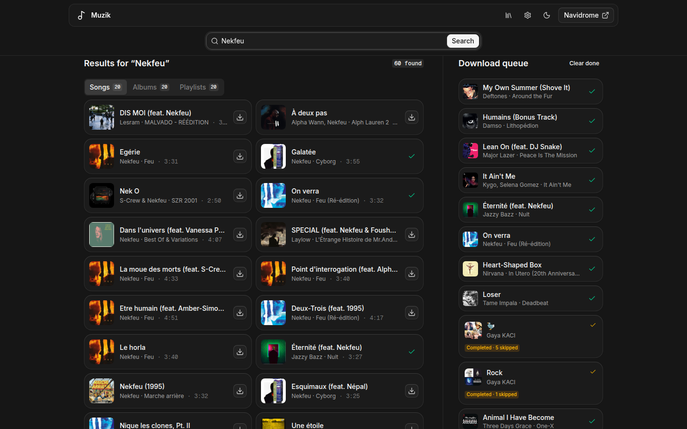
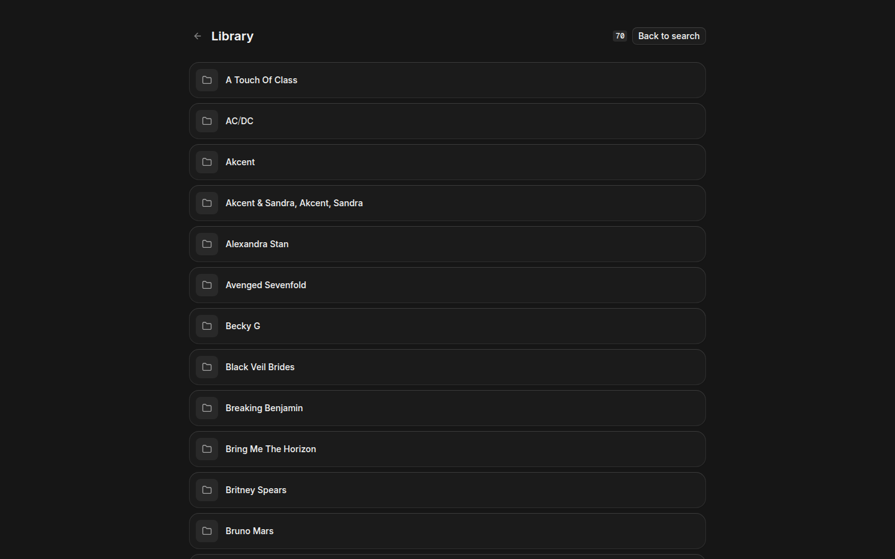

<p align="center">
  
</p>

<h1 align="center">Muzik</h1>

<p align="center">
   <strong>A private YouTube Music streaming player and download front end.</strong><br>
   <em>Play music, save playlists, and keep tagged downloads in your own library.</em>
</p>

<p align="center">
  <a href="https://nextjs.org"></a>
  <a href="https://nodejs.org"></a>
  <a href="https://tailwindcss.com"></a>
  <a href="https://www.docker.com"></a>
  <a href="https://github.com/kacigaya/muzik/blob/main/LICENSE"></a>
</p>

<p align="center">
  <a href="https://kacigaya.github.io/muzik/"><strong>Documentation</strong></a>
</p>

Muzik streams audio through your server. Downloads use an `Artist/Album/Track` layout that Navidrome,
Jellyfin, Plex, or a plain file browser can read. It has no accounts and no database. Likes and playlists are shared on the server.

## Screenshots

### Search and download queue



### Library browser



## Features

- Stream YouTube Music audio with play, pause, seek, volume, and previous/next controls
- Keep playback active across Muzik pages, with media controls on supported browsers
- Add, remove, and reorder songs in a playback queue that restores paused after a reload
- Save liked songs and create, rename, or delete playlists on your server

- Search songs, albums, and playlists from YouTube Music, or paste a YouTube, YouTube Music, SoundCloud, or Bandcamp link
- Expand an album or playlist and queue only the tracks you want
- Follow a collection and Muzik re-checks it on a schedule, downloading whatever was added since
- Serial queue with live progress, speed, and time remaining, persisted to disk and recovered after a restart
- Pick m4a, opus, mp3, or transcoded FLAC
- Album artist, album year, and one broad MusicBrainz genre normalized from the files themselves
- Synced lyrics written next to each track as `.lrc`, on by default and switchable in settings
- Optional Navidrome links and a scan trigger after each download
- Optional Lidarr requests: send an album to Lidarr to monitor and download
- Optional routing of all downloads through a VPN container
- Installable as a PWA, with `/` and `⌘K` shortcuts and light and dark themes

## Quick start

With Docker:

```bash
docker build -t muzik .
docker run -d --name muzik \
  -p 3020:3020 \
  -v /path/to/your/music:/music \
  -v muzik-data:/data \
  muzik
```

From source, with Node.js 22+, Python 3.12+, and ffmpeg on `PATH`:

```bash
npm install
python3 -m venv .venv && .venv/bin/pip install -r requirements.txt
npm run dev
```

Streaming works without a music folder. Open **Settings** to set up downloads, or set
`MUZIK_MUSIC_DIR` before starting Muzik.

**Muzik has no authentication.** Bind it to a private interface or put it behind whatever
front end you already use. See [Deploy](https://kacigaya.github.io/muzik/docs/getting-started/deploy/).

## Streaming

1. Search for a song, album, or YouTube Music playlist.
2. Select **Play** to start a new playback queue. This replaces the current queue.
3. Use **Add to playback queue** to append music without interrupting playback.
4. Use the heart control to save a song. Open **Saved music** in the navigation to create playlists.
5. Expand **Playback queue** above the player to choose, move, or remove tracks.

The server uses the installed yt-dlp to resolve a progressive M4A or WebM audio stream.
Audio passes through Muzik, with byte ranges for seeking. Streaming does not save an
audio file or convert its quality. YouTube audio is lossy. Lossless addons, offline
playback, and YouTube account sync are not included.

Likes and playlists live in `listening.json` under `MUZIK_DATA_DIR`. All users of the
instance share them. Run one app process per data directory. Each browser stores its own queue in local storage, with a limit
of 500 tracks. Playlists hold up to 1000 songs, with up to 100 playlists and 5000 liked
songs per instance. Select individual tracks to play a collection larger than 500 songs.

YouTube can block requests from server IP addresses. If playback fails, try **Retry**
or another track. Keep yt-dlp and the token provider current when YouTube changes its playback endpoints.
Browser and device rules can also limit automatic or background playback.

### Gluetun and proof-of-origin tokens

1. Enable Gluetun's HTTP proxy on port 8888.
2. Set `MUZIK_STREAM_PROXY_URL` to its HTTP proxy URL. Include the proxy credentials when required. Store this setting in a private environment file.
3. Install the [BgUtils token provider](https://github.com/Brainicism/bgutil-ytdlp-pot-provider/tree/2.0.2) version 2.0.2 on the server. The matching yt-dlp plugin is in `requirements.txt`.
4. Bind the provider to loopback, then set `MUZIK_PO_TOKEN_BASE_URL=http://127.0.0.1:4416`. Keep its Node dependencies patched and keep the deployment lockfile.
5. Restart Muzik after changing these settings.

With a token provider configured, playback tries `web_music` and `mweb` with proof-of-origin tokens,
then `android_vr` and `web_embedded`. Without a provider, it tries the latter two clients.
It tries another client when extraction fails or a media URL returns 403, 404, 410,
or 429. This uses yt-dlp's client profiles. It does not add the JVM-based NewPipe extractor.

URL resolution, token generation, and media bytes use the same proxy and VPN exit IP.
The plugin passes the selected proxy to the local token provider. If
`MUZIK_VPN_CONTAINER` is set, streaming requires `MUZIK_STREAM_PROXY_URL` and fails
closed when the proxy is missing or unavailable. Muzik does not fall back to the host
network after a proxy failure. Metadata search uses the existing YouTube Music bridge.

No YouTube account cookies are stored or sent. Tokens improve compatibility but do not
guarantee access to every track or VPN exit IP. Keep the unauthenticated token provider
private. Its upstream setup supports a separate provider container for Docker deployments;
set `MUZIK_PO_TOKEN_BASE_URL` to that container's private address.

## Documentation

Full documentation lives at **<https://kacigaya.github.io/muzik/>**.

- [Install](https://kacigaya.github.io/muzik/docs/getting-started/install/)
- [Deploy](https://kacigaya.github.io/muzik/docs/getting-started/deploy/)
- [Downloads](https://kacigaya.github.io/muzik/docs/guide/downloads/)
- [Audio formats](https://kacigaya.github.io/muzik/docs/guide/audio-formats/)
- [Configuration](https://kacigaya.github.io/muzik/docs/reference/configuration/)
- [Security](https://kacigaya.github.io/muzik/docs/reference/security/)

The site source is in [`web/`](web).

### Lidarr

Enable Lidarr in Muzik's Settings and enter its server URL and API key from
Lidarr **Settings > General**. Use **Test connection** before saving.

Songs and albums in search results then show **Request in Lidarr**. Muzik finds the
matching album in Lidarr, adds it as monitored, and starts a search. Lidarr downloads
and imports it with its own indexers and download clients. A song requests its album.
New artists go into Lidarr's first root folder, or the one set in
**Root folder for new artists**, with that folder's default profiles and no other
albums monitored. Albums Lidarr already has are monitored and searched again.
Environment overrides are listed in the
[configuration reference](https://kacigaya.github.io/muzik/docs/reference/configuration/).

## Development

```bash
npm test         # node --test plus the Python unittest suite
npm run lint
npm run typecheck
npm run build
node scripts/audit_dependencies.mjs
```

GitHub Actions runs all four on every push and pull request, plus `npm audit` and a build
of the Docker image. See
[Development](https://kacigaya.github.io/muzik/docs/reference/development/) for the project
structure.

The audit gate rejects high and critical findings. Until November 7, 2026 UTC, it reports
but excepts [GHSA-vfj7-8cjw-p6xm](https://github.com/advisories/GHSA-vfj7-8cjw-p6xm)
only for dev-only `braces@3.0.3` and its dependent findings. Next.js lint tooling requires
it and no patched release is available. Other advisories, production copies, changed
versions, audit failures, and expiry still fail CI. Remove the exception when upstream
provides a fix.

## Notes

Normal downloads talk to public, anonymous YouTube Music. There is no YouTube login or
cookie jar. Use every source only for content you are allowed to save.

### Album artwork

After downloads, Muzik crops embedded YouTube artwork with solid sidebars to a square
and writes it to `cover.jpg` and back into each audio file. Audio streams are copied
without re-encoding. Navidrome serves embedded artwork for per-track cover requests,
which many Subsonic clients use, so both copies matter. Existing `cover.*`, `folder.*`,
and `front.*` artwork takes priority and is preserved. Square images and landscape
images without solid sidebars are left alone.

Repair existing albums with `node --experimental-strip-types scripts/fix_artwork.mjs`
(using the configured music folder or `MUZIK_MUSIC_DIR`), then rescan the library in
Navidrome. Clients may need to refresh their cached album images.

## License

MIT
